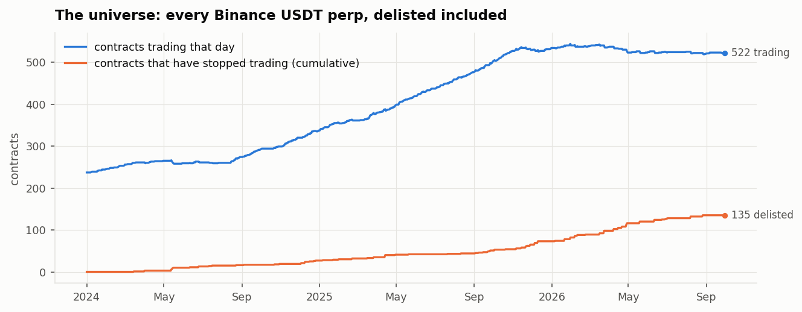
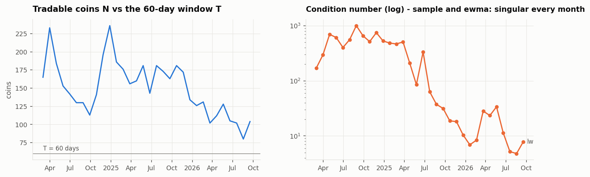
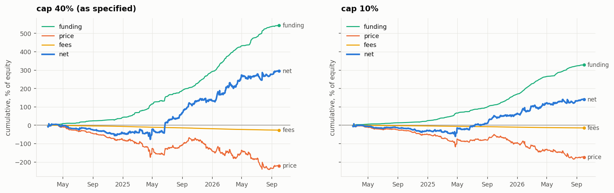
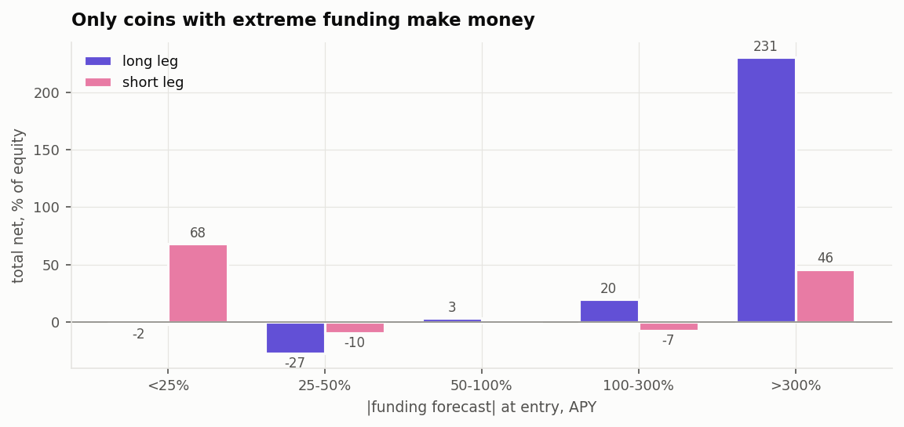
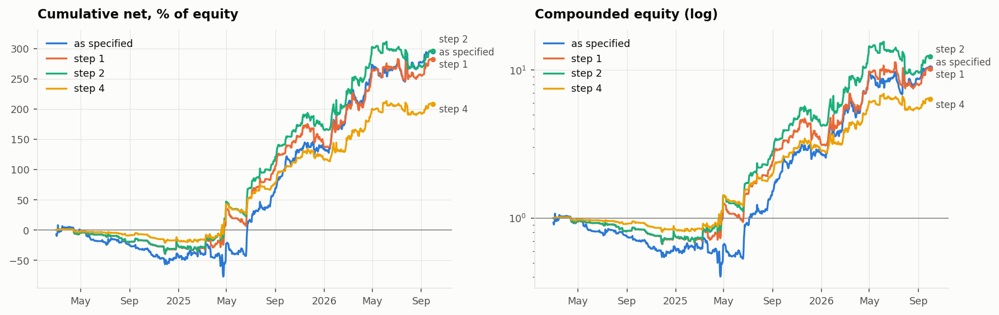
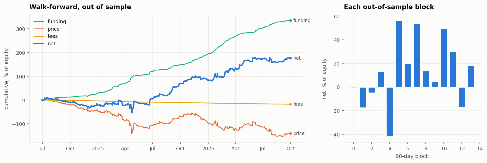
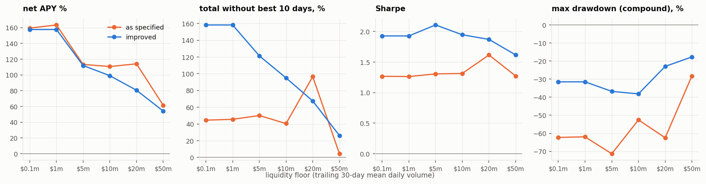

# BetaFunding: a Beta-Neutral Crypto Funding Carry Strategy

## Summary

| | |
|---|---|
| **Strategy type** | Systematic, market-neutral **carry** strategy. Cross-sectional long/short book in Binance crypto **perpetual futures**, rebalanced daily |
| **Trading idea** | Perpetual futures have no expiry; to keep their price near spot, longs and shorts pay each other a **funding rate** every 1–8 hours. When a coin's funding is strongly positive, longs pay shorts, so **short it and collect**; when strongly negative, **long it and collect**. Funding is persistent (half-life ~1.4 days), so tomorrow's is forecastable |
| **What is hedged** | **Market direction.** Net beta to BTC and to ETH is held at zero (±0.02) every day, so a crypto-wide rally or crash does not move the book. What is left is coin-specific risk (~80% of each coin's variance), controlled by a risk penalty, position caps and a stop-loss |
| **Models** | **AR(1)** funding forecast · rolling **joint OLS betas** on BTC and ETH · per-coin **residual variance** as the risk model (**Ledoit–Wolf** shrinkage covariance as the option, because there are more coins than days of data) · **convex optimisation** (cvxpy) each day |
| **Portfolio construction** | Maximise forecast funding − risk penalty − turnover penalty, subject to beta neutrality, 2× gross leverage, 20% single-name cap; trade only coins with \|forecast\| > 300% APY; weight changes under 3% are skipped; 20% stop-loss with a 3-day cooldown |
| **Research method** | Survivorship-bias-free data (667 contracts over 2.5 years, 135 since delisted) · P&L attribution to find where returns came from · parameters chosen on returns *excluding the 10 best days*, so squeezes cannot drive the choice · walk-forward validation on unseen data |

**Results** (Mar 2024 – Sep 2026, coins with ≥ $20m average daily volume, 5 bps fees):

| | Sharpe | Max drawdown (compound) | Without the 10 best days |
|---|---|---|---|
| Strategy as first designed | 1.62 | −62% | +97% |
| **Final strategy** (in-sample) | **1.87** | **−23%** | **+68%** |
| **Walk-forward**, 824 out-of-sample days | **1.45** | −53% | +33% (9 of 14 blocks positive) |

The walk-forward drawdown comes from its first year: with no track record yet, the selector kept
the original design through Apr 2025. From May 2025 it chose the final strategy and 8 of 9
blocks were positive.

**Limitations**: a concentrated book (~3 longs, ~2 shorts at a time); 2024 lost money and the
profit came in 2025–26; the entry threshold, stop-loss and position cap were chosen on the full sample; daily
bars only; backtest only - no live trading record. Sized for a small account (≤ $10k).

The rest of this README is the full process: the original design (§1), data (§2), the problems
met and how each was solved (§3), where the money comes from (§4), the improved strategy and its
validation (§5), and an extension on liquidity (§6). Then the code.

Research only: public data, notebooks run top to bottom, nothing here places an order.

---

## 1. The strategy as first specified

Each day at 00:00 UTC, for weights `w` (signed, fraction of equity):

    max_w   −f̂·w  −  λ·risk(w)  −  γ·Σ|w − w_old|
    s.t.    |Σ w_i β_i| ≤ 0.02 for BTC and for ETH      (market neutral)
            Σ|w_i| ≤ 2,   |w_i| ≤ 0.40                  (gross leverage, single name)
            shorts where f̂ > +10% APY, longs where f̂ < −10% APY
            weight changes under 3% of equity are skipped

`f̂` is tomorrow's funding forecast, `risk(w)` each coin's residual variance after the BTC/ETH
hedge (λ = 10), `γ` a 10 bps execution penalty spread over a ~5-day holding period.

## 2. Data

Every Binance USDT perpetual that traded between Jan 2024 and Sep 2026, **delisted coins
included** (data.binance.vision archive): 667 contracts, 135 of which stopped trading inside the
window. A universe of today's survivors applied to the past picks the winners and makes every
short lose. Each day a coin is tradable if it has 15 days of history and a trailing 30-day mean
daily volume of at least **$20m** (~145 coins on a typical day).



## 3. Problems found, and how each was solved

| # | Problem | What we saw | Fix |
|---|---|---|---|
| 1 | **Survivorship bias** | today's top coins applied back to 2024 made every short lose | the archive universe above, liquidity filtered on trailing volume only |
| 2 | **Forecasting funding** | daily funding is persistent (autocorrelation 0.60, half-life ~1.4 days) | rolling 30-day **AR(1)** (rank IC 0.58 vs 0.55 for an EMA). Today's print alone scores higher still (0.70) - an open point |
| 3 | **What is "the market"?** | five beta definitions scored out of sample; each removes only ~18–23% of a coin's daily variance | **joint** BTC + ETH regression, so the book is neutral to each separately. A single (BTC+ETH)/2 factor removes slightly more variance (23% vs 18%) - an open point |
| 4 | **The covariance matrix** | ~150 coins against a 60-day window: the sample and EWMA covariances are singular every month, and the optimiser levers whatever pair the noise makes look uncorrelated | **per-coin residual variance** (diagonal) by default - best Sharpe (1.62); **Ledoit–Wolf shrinkage** (condition number ~10²) as the option - smaller drawdown, lower Sharpe (1.20). Sample and EWMA lose money without their best days |
| 5 | **The LP sits on corners** | maximising funding alone puts the book in 1–2 coins at the cap | the risk penalty λ·risk(w) |
| 6 | **The 10 bps hurdle** | one day of carry against a one-off fee keeps the book empty | fee spread over the holding period, plus the no-trade band re-solved so the book stays neutral |
| 7 | **Near-zero-carry names used as ballast** | coins at +1% APY enter only for their beta | entry floors per side |
| 8 | **Solver answers outside the constraints** | an "optimal_inaccurate" solve returned a 221× gross book | every solution checked against the constraints |



## 4. Where the money comes from (03)

The book as specified makes +114% APY (Sharpe 1.62): **+210% from funding, −86% from price,
−10% fees**. The hedge does its job - the market part of the price P&L moves 1.9% a year, the
coin-specific part 68% - so the price loss is coin-specific. And it is not spread evenly:

- longs entered with |forecast| > 300% APY make most of the total; the 25–100% buckets lose,
- without its 10 best days the total falls from 295% to 97%; without its 20 best, below zero.




## 5. The improved book (04)

Built up in steps. Steps 1–3 are kept only if they improve the total **without its 10 best
days**, so squeezes cannot drive the choice; step 4 is chosen on drawdown:

| Step | Change | Net APY | Sharpe | Without best 10 days | Max DD (compound) | Worst day |
|---|---|---|---|---|---|---|
| 0 | as specified (+ fixes 1–8) | +114% | 1.62 | +97% | −62% | −21% |
| 1 | trade **only \|forecast\| > 300% APY**, both sides; **BTC/ETH as the hedge** | +109% | 1.73 | +98% | −34% | −20% |
| 2 | **+ 20% stop-loss** (3-day cooldown) | +114% | 1.93 | +127% | −40% | −24% |
| 3 | + drift-adjusted expected return | +72% | 1.50 | +43% | −41% | |
| 4 | **+ 20% single-coin cap** (final) | **+81%** | **1.87** | **+68%** | **−23%** | **−13%** |

Step 1 halves the drawdown at the same return. Step 3 hurts - the price drift it learns overlaps
the funding signal - and is not used. **Step 4**: the remaining drawdown was single-coin jumps on
30–40% positions (a +57% squeeze on a 39% short alone cost 22% of equity) - not market or
momentum exposure, which measure near zero. Capping each coin at 20% halves the drawdown and the
worst day for ~0.06 of Sharpe.



**Walk-forward**: each 60-day block is traded with whichever candidate (steps 0–4, step 0 + drift)
had the best composite score (0.4 Sortino + 0.3 Sharpe + 0.3 Calmar) on all earlier days:

| | Net APY | Sharpe | Without best 10 days | Max DD (compound) |
|---|---|---|---|---|
| walk-forward, 824 days out of sample | +78% | **1.45** | +33% | −53% |
| final strategy on the same 824 days (for reference) | +94% | 2.04 | +71% | −23% |

Positive in 9 of 14 blocks. The selector keeps the original design for the first five blocks
(Jun 2024 – Apr 2025) - the improvements had no track record yet - and that stretch sets the
drawdown (one block −42%). From May 2025 it chooses step 4 (step 2 once): 8 of 9 blocks positive.



### Open points

- **Concentration**: ~3 longs and ~2 shorts at a time; the best 10 of 276 coins make most of the total.
- **Regime**: 2024 loses (−17%); the profit is 2025–26, when extreme-funding events multiplied.
- The 300% floor, the 20% stop and the 20% cap were chosen on the full sample.
- Daily bars: entries, exits and stops at the daily close. Hourly data for the traded coins is next.
- Forecast and hedge: today's funding print and a single (BTC+ETH)/2 factor scored better than the
  AR(1) and the joint beta in isolation; not yet tested inside the book.

## 6. Extension: the liquidity floor (06)

Not part of the main result. Lowering the $20m floor admits thinner coins with wilder funding and
squeezes: the final book makes +158% APY at a $100k floor (Sharpe 1.93, drawdown −31%), +81% at
$20m (1.87, −23%) and +54% at $50m (1.62, −18%). Sharpe is fairly flat from $100k to $20m; the
drawdown is smallest at $20m and above. For a ≤ $10k account any floor is liquid enough - the 95th
percentile position is under 0.02% of the coin's daily volume.



---

## The package (`src/betafunding`)

One package runs both the strategy and the research: data → signals → optimiser → backtest /
target book. `config/strategy.yaml` holds every setting, with the final strategy (step 4) as the
defaults; the design as first specified is `override(cfg, ORIGINAL_SPEC)`, and each notebook
experiment is a few dotted overrides on top. It does not place orders.

```bash
PYTHONPATH=src python -m betafunding refresh           # top up the data with the last 60 days (REST)
PYTHONPATH=src python -m betafunding plan --save       # today's target book; state kept in state/book.json
PYTHONPATH=src python -m betafunding backtest          # full-period backtest of the final strategy
```

| Module | |
|---|---|
| `config.py` | `config/strategy.yaml` as a dict, `override`, `ORIGINAL_SPEC` |
| `data.py` | daily panel from the parquet store; REST top-up |
| `funding.py` | AR(1) funding forecast (EMA for comparison) |
| `beta.py` | joint BTC/ETH betas and the four alternatives, residual variance, hedged returns |
| `risk.py` | covariance estimators: Ledoit–Wolf, sample, EWMA |
| `signals.py` | universe, forecasts, betas, price-drift model, from the config |
| `optimizer.py` | the convex problem, no-trade band, constraint check |
| `backtest.py` | optimiser inputs per day, stop-loss state, daily P&L, summary measures |
| `walkforward.py` | choose a candidate on past days, trade it on the next block |
| `report.py` | the daily plan; book state saved and rolled forward |

## Research notebooks (`research/`)

| # | Notebook | |
|---|---|---|
| 01 | `fetch_data` | the archive universe |
| 02 | `research` | the carry, the five beta definitions, the covariance problem |
| 03 | `pnl_attribution` | long vs short, by forecast size and liquidity, best days and coins, market vs residual, by quarter |
| 04 | `improvements` | steps 1–4, walk-forward, by year and coin |
| 05 | `daily_report` | today's plan for the final strategy |
| 06 | `extension_liquidity` | the liquidity floor (not the main result) |

`research/lib` holds only the archive download (`feeds`) and the plot style. Figures are
written to `research/figures`.

## Reproduce

```bash
pip install -r requirements.txt
jupyter nbconvert --to notebook --execute --inplace research/01_fetch_data.ipynb   # ~15 min
for n in 02_research 03_pnl_attribution 04_improvements 05_daily_report 06_extension_liquidity; do
  jupyter nbconvert --to notebook --execute --inplace research/$n.ipynb            # 02, 04: ~1 h each
done
```

Use one interpreter for fetching and reading: parquet written by pyarrow 23 does not read under
pyarrow 19.

**No look-ahead**: every statistic at row d uses data up to the close of d and trades day d+1;
funding for day d is the settlements stamped inside day d; the liquidity filter, the drift model
and the walk-forward use past days only; delisted coins stay in the data until they stop trading.
